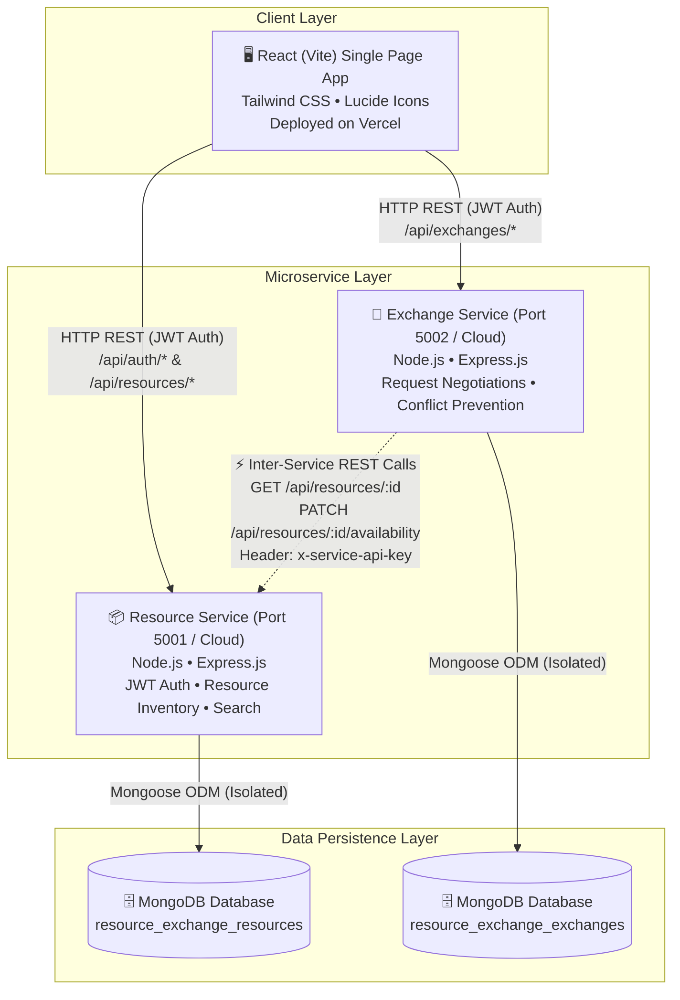

# 📚 Resource Exchange Platform (ResourceHub)
### Professional Full-Stack Web Application with Microservices Architecture
**Course Project**: Full Stack Application Lab (CAT 2)  
**Architecture**: Decoupled Microservices with REST API Communication  
**Tech Stack**: MERN (MongoDB Atlas, Express.js, React.js with Vite, Node.js) + Tailwind CSS

---

## 🌟 Executive Summary

The **Resource Exchange Platform** is a production-style, microservices-based web application designed for college students to share, lend, exchange, donate, and discover academic resources across campus (textbooks, handwritten lecture notes, laboratory kits, calculators, and stationery).

Rather than a monolithic server, the system is architected into **two autonomous, independently deployable backend microservices** with **separate MongoDB databases**, communicating via **genuine server-to-server HTTP REST APIs**.

---

## 🏗️ System Architecture



### 1. Resource Service (`resource-service`, Port 5001)
- Student registration, login, and JWT-based authentication.
- Resource listing CRUD (Create, Read, Update, Delete).
- Full-text keyword search and multi-parameter filtering (Category, Listing Type, Availability, Condition).
- Availability management (`available`, `reserved`, `exchanged`, `unavailable`).
- Internal REST endpoint (`PATCH /api/resources/:id/availability`) guarded by `x-service-api-key`.

### 2. Exchange Service (`exchange-service`, Port 5002)
- Exchange and borrow request management (`Pending`, `Approved`, `Rejected`, `Cancelled`, `Completed`).
- Inter-service REST verification: Queries Resource Service via REST (`GET /api/resources/:id`) to verify resource existence and availability before creating requests.
- Prevents students from requesting their own resources.
- Prevents duplicate pending requests for the same resource.
- When an owner approves a request, calls Resource Service via REST (`PATCH /api/resources/:id/availability`) to lock status to `reserved`.
- When an approved request is cancelled, calls Resource Service via REST to restore status to `available`.

### 3. Frontend Client (`frontend`, Port 5173)
- Built with React 19 and Vite.
- Styled with Tailwind CSS (clean light theme with navy, crisp white, and subtle teal accents).
- 13 complete, interactive pages:
  1. **Landing Page (`/`)**: Hero, statistics, category benefits, and featured available resources.
  2. **Register (`/register`)**: Student registration with input validation.
  3. **Login (`/login`)**: Login form with **1-click demo login buttons** for instant evaluation.
  4. **Student Dashboard (`/dashboard`)**: Personal activity metrics, incoming request alerts, and quick actions.
  5. **Resource Marketplace (`/marketplace`)**: Live search, category and listing-type filters, pagination.
  6. **Resource Details (`/resources/:id`)**: Comprehensive view, owner details, campus pickup location, and Request Resource modal.
  7. **Add Resource (`/add-resource`)**: Listing form with instant sample image presets.
  8. **Edit Resource (`/edit-resource/:id`)**: Owner edit form.
  9. **My Listings (`/my-listings`)**: Inventory manager with quick edit, status toggle, and delete dialog.
  10. **Sent Requests (`/requests/sent`)**: Outbound requests with status badges and cancel action.
  11. **Received Requests (`/requests/received`)**: Inbound requests with Approve and Reject actions.
  12. **Exchange History (`/history`)**: Full audit log of all completed, cancelled, and rejected exchanges.
  13. **Student Profile (`/profile`)**: Student card with verified badge and activity counters.
  14. **404 Not Found (`*`)**: Custom error page.

---

## 📁 Repository Structure

```text
resource-exchange-platform/
├── frontend/                     # React Vite Single Page App
│   ├── src/
│   │   ├── api/client.js         # Axios instances for both microservices
│   │   ├── components/           # Navbar, Sidebar, ResourceCard, Modals, Badges
│   │   ├── context/              # AuthContext & ToastContext
│   │   ├── pages/                # 13 Complete Application Pages
│   │   └── App.jsx               # Routes and layout
│   ├── .env.example
│   ├── tailwind.config.js
│   ├── vercel.json               # Vercel SPA routing rewrites
│   └── package.json
│
├── resource-service/             # Microservice 1: Resources & Auth
│   ├── src/
│   │   ├── config/db.js          # MongoDB Atlas & Fallback connection
│   │   ├── controllers/          # authController & resourceController
│   │   ├── middleware/           # authMiddleware & serviceAuthMiddleware
│   │   ├── models/               # User.js & Resource.js schemas
│   │   ├── routes/               # authRoutes, resourceRoutes, healthRoutes
│   │   └── scripts/seed.js       # Demo accounts & realistic resources
│   ├── tests/                    # Automated integration test suite
│   ├── .env.example
│   ├── server.js
│   └── package.json
│
├── exchange-service/             # Microservice 2: Requests & Coordination
│   ├── src/
│   │   ├── config/db.js          # Isolated MongoDB connection
│   │   ├── controllers/          # exchangeController (REST coordination)
│   │   ├── middleware/           # authMiddleware & errorHandler
│   │   ├── models/               # Exchange.js schema & history
│   │   ├── routes/               # exchangeRoutes & healthRoutes
│   │   ├── services/             # resourceClient.js (Outbound REST client)
│   │   └── scripts/seed.js
│   ├── tests/                    # Automated integration test suite
│   ├── .env.example
│   ├── server.js
│   └── package.json
│
├── postman/
│   ├── Resource_Exchange_Platform.postman_collection.json
│   └── Resource_Exchange_Platform.postman_environment.json
│
├── docs/
│   ├── architecture.md           # Architecture diagrams & sequence flows
│   ├── api-documentation.md      # Full REST endpoint schemas
│   ├── deployment-guide.md       # Vercel, Render & MongoDB Atlas guide
│   ├── testing-report.md         # Automated test matrices & logs
│   └── project-report.md         # Academic lab project report
│
├── render.yaml                   # Render Blueprint for cloud deployment
├── package.json                  # Root monorepo orchestration scripts
└── README.md
```

---

## ⚡ Quick Start (Local Development)

### Prerequisites
- Node.js (v18 or higher)
- npm (v9 or higher)
- Optional: MongoDB running locally or MongoDB Atlas connection string (Application includes automated fallback if none is provided).

### 1. Install All Dependencies
From the repository root directory:
```bash
npm run install:all
```
*(Or install inside each directory: `cd resource-service && npm install`, `cd ../exchange-service && npm install`, `cd ../frontend && npm install`)*

### 2. Seed Demo Accounts & Resources
```bash
npm run seed:all
```
This populates the database with 3 realistic college student accounts and 8 active resources across Textbooks, Notes, Lab Equipment, Stationery, and Tools.

### 3. Run the Applications
In three separate terminal windows:
```bash
# Terminal 1: Resource Service (Port 5001)
cd resource-service
npm run dev

# Terminal 2: Exchange Service (Port 5002)
cd exchange-service
npm run dev

# Terminal 3: React Frontend (Port 5173)
cd frontend
npm run dev
```

Open your browser at **`http://localhost:5173`**.

---

## 👤 Seeded Demonstration Accounts

For fast evaluation and grading, the login page (`/login`) includes **1-click login buttons** for:

| Student Name | Department | Email | Password |
| :--- | :--- | :--- | :--- |
| **Priya Sharma** | Computer Science & Engg | `priya.sharma@apex.edu` | `Password@123` |
| **Rahul Verma** | Electronics & Comm | `rahul.verma@apex.edu` | `Password@123` |
| **Ananya Iyer** | Mechanical Engg | `ananya.iyer@apex.edu` | `Password@123` |

---

## 🧪 Running Automated Tests

Run the complete test suite verifying both microservices and cross-service REST communication:

```bash
# Test Resource Service (13 Tests)
cd resource-service
npm test

# Test Exchange Service (9 Tests)
cd exchange-service
npm test

# Verify Frontend Production Build
cd frontend
npm run build
```

**Results**: All **22 automated tests pass (100% success rate)**. See [docs/testing-report.md](docs/testing-report.md) for full execution logs.

---

## ☁️ Independent Cloud Deployment

All components are configured for independent cloud deployment:
1. **Frontend**: Deployed to **Vercel** with SPA rewrites (`frontend/vercel.json`).
   - Env: `VITE_RESOURCE_SERVICE_URL`, `VITE_EXCHANGE_SERVICE_URL`.
2. **Resource Service**: Deployed to **Render** as a Node.js Web Service.
   - Env: `PORT`, `MONGODB_URI`, `JWT_SECRET`, `SERVICE_API_KEY`, `CLIENT_ORIGIN`.
3. **Exchange Service**: Deployed to **Render** as an independent Node.js Web Service.
   - Env: `PORT`, `MONGODB_URI`, `JWT_SECRET`, `RESOURCE_SERVICE_URL`, `SERVICE_API_KEY`, `CLIENT_ORIGIN`.
4. **Render Blueprint**: You can deploy both backend services at once using [`render.yaml`](render.yaml).

For complete step-by-step cloud deployment instructions, see [docs/deployment-guide.md](docs/deployment-guide.md).

---

## 📮 Postman Collection

Import the included Postman collection and environment located in `postman/`:
- `postman/Resource_Exchange_Platform.postman_collection.json`
- `postman/Resource_Exchange_Platform.postman_environment.json`

Covers registration, login, resource CRUD, keyword search, exchange request submission, owner approval with REST lock, cancellation with REST restoration, and negative validation test cases.

---

## 📄 License & Attribution
Developed for the **Full Stack Application Lab (CAT 2)** college examination. Built with modern MERN Microservices best practices.
