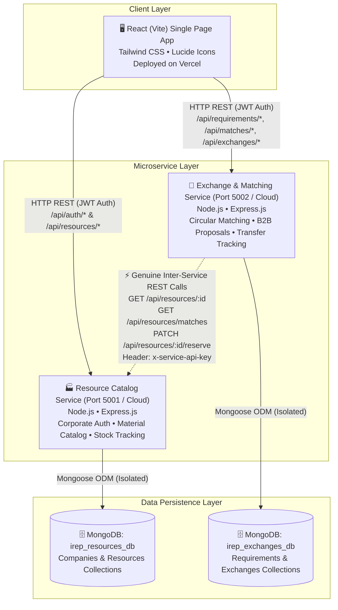

# 🏭 Industrial Resource Exchange Platform (IREP)
### Full-Stack Industrial By-Product and Surplus Resource Marketplace
**System Architecture**: Decoupled Microservices with Isolated Databases & REST Coordination  
**Tech Stack**: MERN (MongoDB Atlas, Express.js, React.js with Vite, Node.js) + Tailwind CSS

---

## 🌟 Executive Summary

The **Industrial Resource Exchange Platform (IREP)** is a production-grade B2B digital marketplace engineered to facilitate **industrial circular symbiosis**. The platform connects manufacturing facilities that generate surplus, by-product, recyclable, or recoverable materials with secondary industrial processors that utilize those materials as manufacturing inputs.

Rather than a monolithic backend, the platform is architected into **two independent, autonomous microservices** (`resource-service` on port 5001 and `exchange-service` on port 5002) with **isolated MongoDB databases** (`irep_resources_db` and `irep_exchanges_db`), communicating via **authentic server-to-server HTTP REST APIs** protected by a shared secret (`x-service-api-key`).

---

## 🏗️ System Architecture



---

## 📦 The 10 Industrial Material Categories

1. **Textile and fabric waste**: Cotton comber noil, yarn offcuts, polyester trimmings.
2. **Metal scraps**: High-carbon steel turning scraps, aluminum borings, copper slag.
3. **Plastic waste and reusable polymers**: Recycled HDPE flakes, clean post-industrial PP granules.
4. **Paper and cardboard**: Corrugated cardboard bales, unbleached kraft paper trims.
5. **Wood scraps and sawdust**: Kiln-dried pine sawdust, wood chip residues.
6. **Agricultural by-products**: Bagasse, rice husk, coconut coir pith.
7. **Construction and demolition materials**: Crushed concrete aggregate, reclaimed bricks.
8. **Reusable industrial packaging**: 210-litre steel drums, chemical IBC totes, wooden euro pallets.
9. **Surplus raw materials**: Overstock virgin pigments, masterbatches, industrial solvents.
10. **Other recoverable industrial by-products**: Fly ash, furnace slag, spent foundry sand.

---

## 🖥️ 17 Functional Frontend Pages

1. **Landing Page (`/`)**: Circular economy principles, industrial statistics (landfill diversion, CO2 abatement), and catalog preview.
2. **Corporate Sign In (`/login`)**: Enterprise login featuring **1-click evaluator demo accounts**.
3. **Enterprise Registration (`/register`)**: Corporate onboarding with GSTIN/CIN reference, industrial sector, and facility address.
4. **Industrial Dashboard (`/dashboard`)**: Inventory statistics, active proposals, recent transactions, and microservice REST health indicators.
5. **Material Marketplace (`/marketplace`)**: Search, multi-criteria filtering, and **Grid Card / Registry Table view switcher**.
6. **Material Details (`/resources/:id`)**: Technical specifications, composition, pickup facility, MSDS compliance, and B2B proposal launcher.
7. **Publish Resource (`/add-resource` / `/publish-resource`)**: Material registration with volume, unit rates, safety instructions, and hazardous declarations.
8. **Edit Resource (`/edit-resource/:id`)**: Edit specifications, inventory availability, and indicative prices.
9. **Enterprise Inventory (`/my-listings`)**: Track unreserved vs. reserved quantities across listings with status controls and deletion.
10. **Post Procurement Need (`/requirements/new`)**: Material procurement form with required volumes, quality thresholds, and budget caps.
11. **Circular Matching Results (`/matching`)**: Cross-service circular matching engine returning ranked listings with **Compatibility Scores (0–100%)** and factor breakdown insights.
12. **Outbound Proposals (`/requests/sent`)**: Monitor procurement proposals, counter-offers, and cancellation actions.
13. **Inbound Proposals (`/requests/received`)**: Review incoming bids with **Accept (coordinates atomic stock reservation over REST)** and Decline actions.
14. **Negotiation & Exchange Details (`/exchanges/:id`)**: Price counter-proposals, discussion thread, and microservice audit timeline.
15. **Transfer Tracking & History (`/history`)**: Freight consignment tracking (carrier, waybill ref, dispatch date) and completed transfer logs.
16. **Enterprise Profile (`/profile`)**: Corporate profile with GSTIN reference, sector, and official **Verification Badge** (`Verified`, `Pending`, `Rejected`).
17. **Admin Dashboard (`/admin`)**: Company verification queue (approving/rejecting registrations) and catalog listing moderation.

---

## ⚡ 1-Click Fast Evaluator Accounts

On the `/login` screen, evaluators can click any of the pre-configured enterprise buttons to instantly sign in without manual typing:

| Enterprise Name | Role / Sector | Login Email | Password | Location |
| :--- | :--- | :--- | :--- | :--- |
| **Apex Industrial Textiles** | Supplier & Receiver (Textiles) | `karthik@apextextiles.com` | `Password@123` | Coimbatore, TN |
| **Kalyani Forge & Alloy** | Supplier & Receiver (Metals) | `rajesh@kalyaniforge.com` | `Password@123` | Pune, MH |
| **GreenLeaf Polymers** | Supplier & Receiver (Plastics) | `sneha@greenleafpolymers.com` | `Password@123` | Vadodara, GJ |
| **Sahyadri Eco-Board** | Supplier & Receiver (Woodwork) | `mahesh@sahyadriboards.com` | `Password@123` | Hubballi, KA |
| **Platform Administrator** | Platform Governance & Verification | `admin@irep.gov.in` | `AdminPassword@123` | National Portal |

---

## 🚀 How to Run Locally

### Option A: 1-Click Windows Launcher (Recommended)
Double-click `run.bat` in the root folder. It will automatically:
1. Check dependencies across all three applications.
2. Clean any lingering processes on ports `5001`, `5002`, and `5173`.
3. Seed demonstration industrial accounts and catalog listings into both databases.
4. Launch Resource Service (:5001), Exchange Service (:5002), and Frontend (:5173) in independent terminal windows.
5. Launch your browser directly to `http://localhost:5173`.

To cleanly terminate all running services at any time, run `stop.bat`.

---

### Option B: Manual Multi-Terminal Startup

#### Terminal 1: Resource Service (Port 5001)
```bash
cd resource-service
npm install
npm run seed
npm start
```

#### Terminal 2: Exchange Service (Port 5002)
```bash
cd exchange-service
npm install
npm run seed
npm start
```

#### Terminal 3: React Frontend Client (Port 5173)
```bash
cd frontend
npm install
npm run dev
```

---

## 🧪 Automated Testing & Postman

### Running Automated Test Suites
Both microservices include automated unit and integration tests using Jest and Supertest:
```bash
# Run Resource Service tests (7/7 passed)
cd resource-service
npm test

# Run Exchange Service tests (6/6 passed)
cd exchange-service
npm test
```

### Postman Collections
Import the pre-configured collections located in the `postman/` directory:
- `postman/Resource_Exchange_Platform.postman_collection.json`
- `postman/Resource_Exchange_Platform.postman_environment.json`

---

## ☁️ Independent Cloud Deployment Guide

| Component | Target Platform | Root Directory | Build Command | Start / Output |
| :--- | :--- | :--- | :--- | :--- |
| **Frontend** | Vercel | `frontend` | `npm run build` | `dist` |
| **Resource Service** | Render | `resource-service` | `npm install` | `npm start` |
| **Exchange Service** | Render | `exchange-service` | `npm install` | `npm start` |
| **Databases** | MongoDB Atlas | *N/A* | *Cluster M0* | `irep_resources_db` & `irep_exchanges_db` |

For detailed environment variables and deployment instructions, refer to [`docs/deployment-guide.md`](file:///c:/college/full%20stack%20CAT%202/docs/deployment-guide.md).

---

## 📚 Complete Project Documentation

- **Architecture Documentation**: [`docs/architecture.md`](file:///c:/college/full%20stack%20CAT%202/docs/architecture.md)
- **API Documentation**: [`docs/api-documentation.md`](file:///c:/college/full%20stack%20CAT%202/docs/api-documentation.md)
- **Testing & QA Report**: [`docs/testing-report.md`](file:///c:/college/full%20stack%20CAT%202/docs/testing-report.md)
- **Academic Project Report**: [`docs/project-report.md`](file:///c:/college/full%20stack%20CAT%202/docs/project-report.md)
- **Deployment Guide**: [`docs/deployment-guide.md`](file:///c:/college/full%20stack%20CAT%202/docs/deployment-guide.md)
