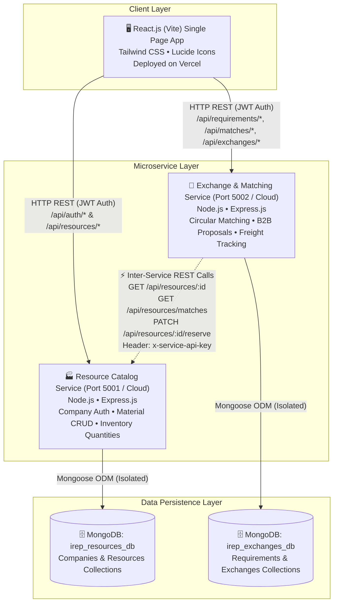
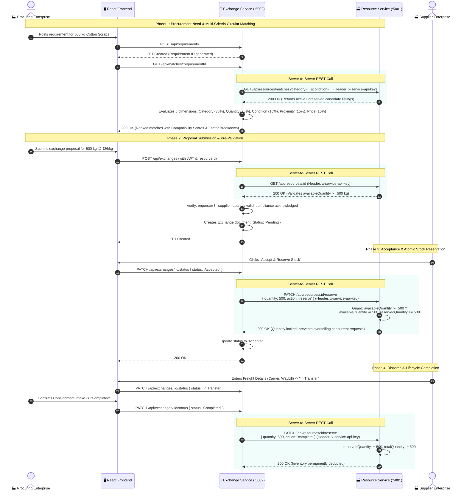

# System Architecture Documentation
## Industrial Resource Exchange Platform (IREP)

### 1. High-Level Architectural Overview

The **Industrial Resource Exchange Platform (IREP)** is a B2B circular economy marketplace connecting manufacturing plants with surplus, by-product, or recoverable materials to secondary industrial processors. The system is engineered around a decoupled **Microservices Architecture**:

1. **Frontend Client (Port 5173 / Vercel)**:
   - React 19 single-page application built with Vite and Tailwind CSS.
   - Comprehensive industrial user interface: Material Marketplace (with grid and table views), Multi-Criteria Circular Matching Engine, Proposal Negotiation Threads, Transfer Tracking, Enterprise Verification Management, and Platform Administration.
2. **Microservice A: Resource Catalog Service (`resource-service`, Port 5001 / Cloud)**:
   - Manages industrial enterprise authentication, corporate profiles (GSTIN/CIN references), and the 10 industrial material categories.
   - Handles material CRUD, multi-attribute search, quantity tracking (`totalQuantity`, `availableQuantity`, `reservedQuantity`), material safety data (MSDS), and compliance info.
   - Backed by its own isolated MongoDB database (`irep_resources_db`).
3. **Microservice B: Exchange & Matching Service (`exchange-service`, Port 5002 / Cloud)**:
   - Stores receiver procurement requirements (`Requirement` model).
   - Executes the multi-criteria circular matching algorithm comparing category keywords, volume availability, condition grade, geographic proximity, and price alignment.
   - Manages B2B exchange proposals, counter-offer negotiation threads, freight consignment tracking, and status transitions (`Pending`, `Under Negotiation`, `Accepted`, `Rejected`, `Cancelled`, `In Transfer`, `Completed`).
   - Backed by its own isolated MongoDB database (`irep_exchanges_db`).
4. **Inter-Service REST Protocol**:
   - The Exchange Service communicates directly with the Resource Service over authenticated HTTP REST calls using `x-service-api-key`.
   - **Zero Shared Database Access**: Data is never shared via common database collections or direct connections.

---

### 2. Component Architecture Diagram

---

### 3. Inter-Service Communication Sequence Diagram

This sequence diagram illustrates the compulsory server-to-server REST communication during requirement matching, proposal submission, and atomic stock reservation:

---

### 4. Database Isolation & Schemas

Each microservice communicates exclusively with its own independent database:

#### A. Resource Service Database (`irep_resources_db`)
- **`companies` Collection**:
  - `_id`: ObjectId
  - `companyName`: String
  - `registrationNumber`: String (GSTIN / Corporate Identification Number)
  - `industrySector`: String
  - `contactPerson`: String
  - `email`: String (Unique, Indexed)
  - `password`: String (Bcrypt salted hash)
  - `phone`, `address`, `city`, `state`, `country`
  - `description`: String
  - `verificationStatus`: Enum (`Pending`, `Verified`, `Rejected`)
  - `role`: Enum (`company`, `admin`)
  - `createdAt`, `updatedAt`: Timestamps
- **`resources` Collection**:
  - `_id`: ObjectId
  - `title`: String (Text Indexed)
  - `description`: String (Text Indexed)
  - `category`: Enum (The 10 industrial categories)
  - `resourceType`: Enum (`By-product`, `Scrap`, `Surplus`, `Reusable Material`, `Recyclable Material`)
  - `supplierCompanyId`: String (Indexed)
  - `supplierCompanyDisplayName`: String
  - `totalQuantity`, `availableQuantity`, `reservedQuantity`: Numbers
  - `unit`: String (`kg`, `tonnes`, `litres`, `units`, `meters`, `drums`)
  - `materialCondition`: Enum (`Virgin Surplus`, `Production Scrap`, `Reconditioned`, `Recycled Aggregate`, `Used/Secondary`)
  - `composition`: String (Chemical/Polymer grade)
  - `intendedUse`: String
  - `pricePerUnit`, `currency`: Number & String
  - `minOrderQuantity`: Number
  - `pickupLocation`: `{ address, city, state, country, loadingEquipmentAvailable }`
  - `safetyHandling`: String
  - `compliance`: `{ hazardousMaterial, pcbCategory, msdsUrl }`
  - `availabilityStatus`: Enum (`available`, `partially_reserved`, `reserved`, `transferred`, `withdrawn`)

#### B. Exchange Service Database (`irep_exchanges_db`)
- **`requirements` Collection**:
  - `_id`: ObjectId
  - `materialCategory`: String
  - `materialTitle`: String
  - `specificationDetails`: String
  - `requiredQuantity`: Number
  - `unit`: String
  - `acceptableCondition`: String
  - `deliveryLocation`: `{ city, state, country, facilityAddress }`
  - `maxBudgetPerUnit`, `currency`: Number & String
  - `requiredByDate`: Date
  - `handlingRequirements`: String
  - `receiverCompanyId`, `receiverCompanyName`, `receiverEmail`: String
  - `status`: Enum (`Active`, `Matched`, `Fulfilled`, `Cancelled`)
- **`exchanges` Collection**:
  - `_id`: ObjectId
  - `resourceId`: String (Indexed reference to Resource listing)
  - `resourceTitle`, `materialCategory`: String
  - `supplierCompanyId`, `supplierCompanyName`, `supplierEmail`: String
  - `receiverCompanyId`, `receiverCompanyName`, `receiverEmail`: String
  - `requestedQuantity`: Number
  - `unit`: String
  - `proposedPricePerUnit`, `totalProposedAmount`: Numbers
  - `proposalMessage`, `deliveryTerms`: String
  - `complianceAck`: Boolean
  - `status`: Enum (`Pending`, `Under Negotiation`, `Accepted`, `Rejected`, `Cancelled`, `In Transfer`, `Completed`)
  - `negotiationNotes`: Array of `{ senderId, senderName, message, proposedPrice, timestamp }`
  - `transferTracking`: `{ carrierName, trackingRef, dispatchDate, transferNotes }`
  - `statusHistory`: Array of `{ status, changedAt, changedBy, note }`

---

### 5. Multi-Criteria Circular Matching Engine

The matching engine in `exchange-service/src/services/matchingService.js` scores compatibility across 5 distinct dimensions:

$$\text{Compatibility Score} = W_{cat} + W_{qty} + W_{cond} + W_{prox} + W_{price}$$

1. **Category & Keyword Alignment (35% Weight)**: Strict category match awards 25 points; matching title keywords in description/specifications awards up to 10 points.
2. **Quantity & Volume Compatibility (25% Weight)**: Verifies compatible measurement units (handling ton-to-kg unit conversion factors). Evaluates if unreserved stock fulfills 100% or partial requirements.
3. **Material Condition Alignment (15% Weight)**: Matches supplier scrap/surplus condition grade against receiver acceptability threshold.
4. **Geographic Proximity (15% Weight)**: City-level match awards full 15 points (zero regional freight overhead); State-level match awards 10 points; interstate awards 5 points.
5. **Price & Budget Alignment (10% Weight)**: Full 10 points if proposed rate is within buyer's budget cap, scaled proportionally.

---

### 6. Atomic Quantity Reservation & Anti-Overselling Guard

To handle concurrent purchase bids without distributed transaction overhead:
- Stock is segmented into: `totalQuantity = availableQuantity + reservedQuantity`.
- When an exchange proposal is `Accepted`, the Exchange Service calls:
  `PATCH /api/resources/:id/reserve` with `{ quantity, action: 'reserve' }`.
- The Resource Service executes an atomic MongoDB findOneAndUpdate with condition `{ availableQuantity: { $gte: quantity } }`.
- If insufficient unreserved stock remains, the service immediately returns `409 Conflict`, completely preventing overselling.
- Upon cancellation, the action `'release'` restores `availableQuantity`.
- Upon final transfer completion, the action `'complete'` decrements `reservedQuantity` and `totalQuantity`.
