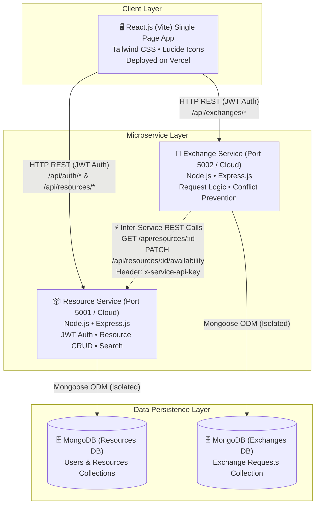
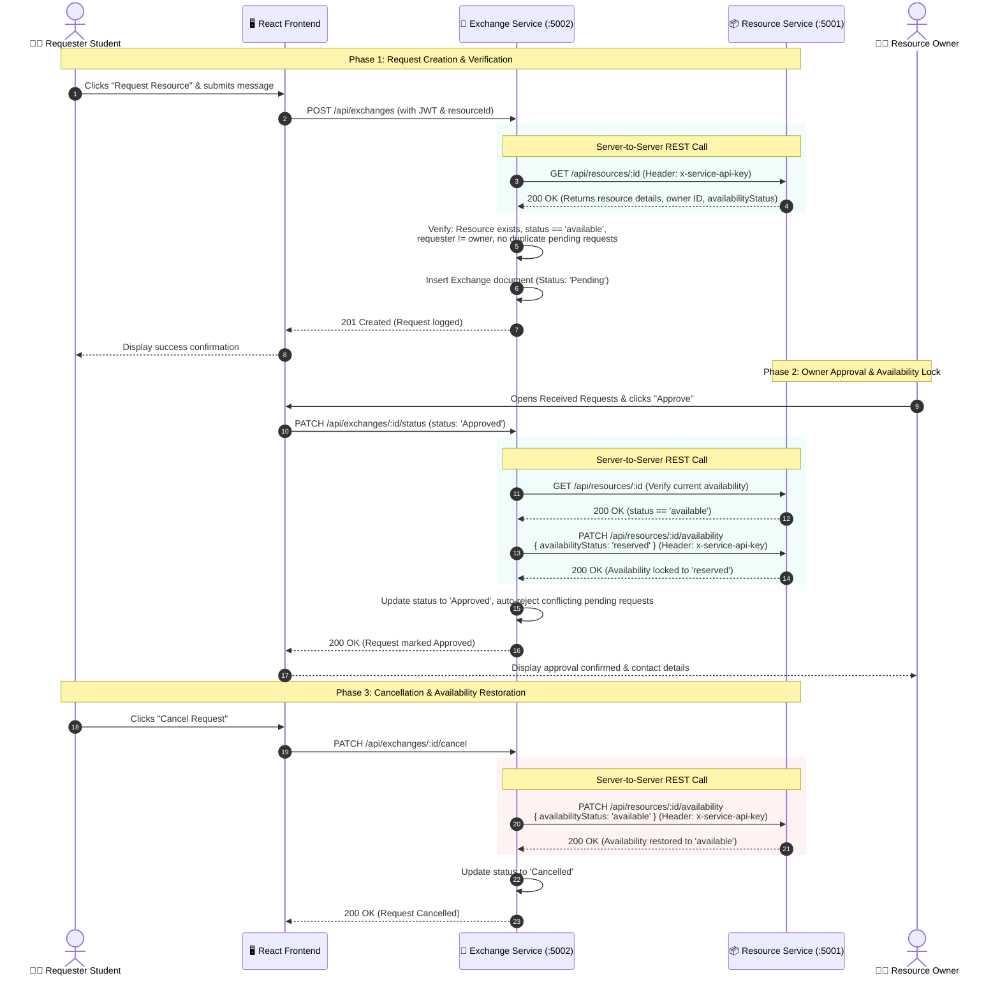

# System Architecture Documentation
## Resource Exchange Platform for College Students

### 1. High-Level Architectural Overview

The **Resource Exchange Platform** is engineered following a decoupled **Microservices Architecture**. Rather than deploying a monolithic backend, the platform isolates core domain capabilities into two autonomous microservices, each with its own database, lifecycle, and API surface:

1. **Frontend Client**: Built with React (Vite) and Tailwind CSS, providing a responsive single-page application (SPA).
2. **Resource Microservice (`resource-service`)**: Owns student authentication, student profiles, and the complete resource catalog lifecycle (CRUD, search, filtering, availability flags). Powered by its own isolated MongoDB database.
3. **Exchange Microservice (`exchange-service`)**: Manages the request lifecycle, conflict resolution, request negotiation, and status updates (Approve, Reject, Cancel, Complete). Powered by its own independent MongoDB database.
4. **Inter-Service REST Bridge**: The Exchange Service communicates directly with the Resource Service over standard HTTP REST APIs protected by a shared server-side secret (`x-service-api-key`), ensuring full data consistency without shared database access.

---

### 2. Component Architecture Diagram

---

### 3. Inter-Service Communication Sequence Diagram

This sequence diagram illustrates the compulsory server-to-server REST communication during request creation and approval.

---

### 4. Database Schema & Isolation

Each microservice communicates exclusively with its own database:

#### A. Resource Service Database (`resource_exchange_resources`)
- **`users` Collection**:
  - `_id`: ObjectId
  - `name`: String
  - `email`: String (Unique, Indexed)
  - `password`: String (Bcrypt salted hash)
  - `collegeName`: String
  - `department`: String
  - `profileImage`: String
  - `createdAt`, `updatedAt`: Timestamps
- **`resources` Collection**:
  - `_id`: ObjectId
  - `title`: String (Text Indexed)
  - `description`: String (Text Indexed)
  - `category`: Enum (`Textbooks`, `Notes & Study Materials`, `Lab Equipment`, `Stationery`, `Calculators & Tools`, `Electronics & Hardware`, `Other`)
  - `listingType`: Enum (`Lend`, `Exchange`, `Donate`, `Give Away`)
  - `condition`: Enum (`New`, `Like New`, `Good`, `Fair`)
  - `owner`: `{ id, name, email, collegeName, department }`
  - `imageUrl`: String
  - `exchangePreference`: String (for Exchange listings)
  - `lendingDuration`: String (for Lend listings)
  - `location`: String (Campus pickup point)
  - `availabilityStatus`: Enum (`available`, `reserved`, `exchanged`, `unavailable`)
  - Compound Indexes: `(category, listingType, availabilityStatus)`, `(owner.id)`

#### B. Exchange Service Database (`resource_exchange_exchanges`)
- **`exchanges` Collection**:
  - `_id`: ObjectId
  - `resourceId`: String (Indexed reference to Resource Service resource)
  - `resourceTitle`: String
  - `resourceCategory`: String
  - `resourceImageUrl`: String
  - `requesterId`: String (Indexed reference to student User)
  - `requesterName`: String
  - `requesterEmail`: String
  - `requesterCollege`: String
  - `requesterDepartment`: String
  - `ownerId`: String (Indexed reference to resource owner User)
  - `ownerName`: String
  - `ownerEmail`: String
  - `requestMessage`: String
  - `requestType`: Enum (`Lend`, `Exchange`, `Donate`, `Give Away`)
  - `exchangeItemOffered`: String
  - `durationRequested`: String
  - `status`: Enum (`Pending`, `Approved`, `Rejected`, `Cancelled`, `Completed`)
  - `statusHistory`: Array of `{ status, changedAt, changedBy, note }`
  - Compound Indexes: `(requesterId, status)`, `(ownerId, status)`, `(resourceId, requesterId, status)`

---

### 5. Inter-Service Security & Network Reliability

1. **Authentication Guard**:
   - Outbound REST calls originating from `exchange-service` transmit the header `x-service-api-key`.
   - The `resource-service` inspects this key using `serviceAuthMiddleware.js`. If valid, it grants privileged access to update availability status on behalf of the exchange engine without requiring an interactive student session.
2. **Network Timeout & Circuit Handling**:
   - In `resourceClient.js`, outbound REST requests utilize an explicit `7000ms` connection timeout.
   - Handlers specifically differentiate between `ECONNREFUSED` (Service down), `ECONNABORTED` (Timeout), and `4xx/5xx` HTTP responses, avoiding hanging thread pools and returning actionable HTTP error messages to clients.
